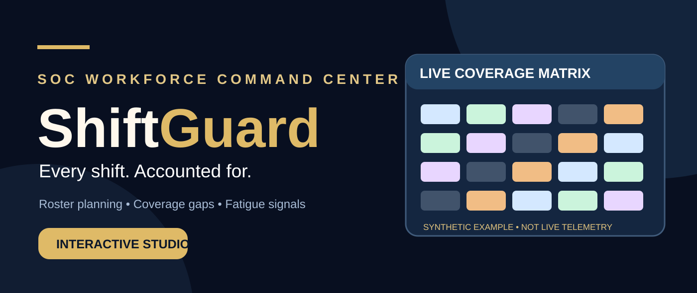
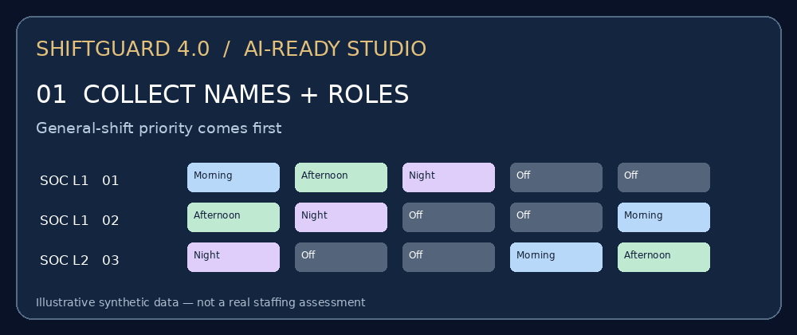
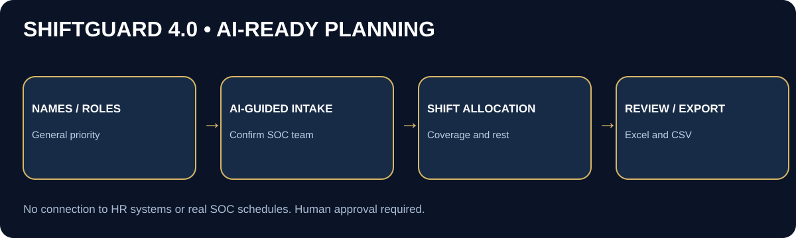

<div align="center">



### AI-Ready SOC Workforce Studio · General-Shift Priority · Coverage Diagnostics · Local-first

[](https://github.com/amitambekar510/ShiftGuard-SOC-Roster-Management/actions/workflows/ci.yml)
[](studio/)
[](shiftguard.py)

**[Open the interactive studio](https://amitambekar510.github.io/ShiftGuard-SOC-Roster-Management/)** · [Python CLI](#python-roster-generator) · [Coverage explained](#what-does-a-coverage-gap-mean)

</div>

## 🎞️ ShiftGuard 4.0 — animated project walkthrough

<div align="center">


*Illustrative animation using fictional analysts. Not real SOC staffing data.*


</div>

## 🤖 ShiftGuard 4.0 — AI-first roster creation

Copy this prompt into an AI assistant that can read the repository and execute Python:

```text
Read AI_INSTRUCTIONS.md from the ShiftGuard-SOC-Roster-Management
GitHub repository. First ask me for names and roles of General-shift
priority staff, then names and roles of rotating SOC analysts.
Confirm month and minimum L1/L2 coverage. Generate and review
the Excel roster using ai_roster.py and disclose all coverage gaps.
```

Run the local guided wizard without an AI subscription:

```bash
python -m pip install -r requirements.txt
python ai_roster.py
```

Or use synthetic example data:

```bash
python ai_roster.py --config examples/team.sample.json --fail-on-gaps
```

The wizard creates `ShiftGuard_AI_Roster.xlsx` and `ShiftGuard_Roster_Review.json`. It preserves General-shift priority, validates assigned L1/L2 coverage, and reports rest/rotation warnings. General shift assumes weekdays only. This is a planning heuristic, not a legal compliance or fatigue safety guarantee. Review results before adoption.

[AI assistant instructions](AI_INSTRUCTIONS.md) · [Agent guidance](AGENTS.md) · [Sample team](examples/team.sample.json)

## 🚀 What's new in ShiftGuard 4.0?

| Feature | Status |
|---|---|
| Interactive, responsive browser roster | Available in `studio/` |
| Click-to-edit shift assignments | Morning → Afternoon → Night → Off → Leave |
| Coverage diagnostics | Per day, role, and actual assigned shift |
| Rest/rotation warnings | Consecutive nights and Night → Morning/Afternoon transitions |
| Staffing thresholds | Configurable minimum L1 and L2 per shift |
| Local CSV export | No account or backend |
| Python Excel generator | Retained from v2; produces 4-sheet XLSX |
| Demo data | Synthetic analysts only |

> [!IMPORTANT]
> **The demo's red coverage gaps are warnings about generated example assignments, not evidence that your actual SOC has staffing shortages.** This repository cannot see your real shift roster. Neither the web demo nor Python generator guarantees safe scheduling or legal compliance.

## What does a coverage gap mean?

A **Night ❌ Coverage Gap** occurs when, for example, a Night shift requires **1 L1 analyst**, but **0 L1 analysts** are actually scheduled. This is a **gap in the calculated sample schedule**. It is **not** proof that your organization's real SOC is missing an analyst. For real-world validation, provide an approved team configuration and review shift handovers, leaves, skill requirements, on-call support, rest breaks, and local labor requirements.

## 🖥️ Interactive Studio

The browser studio is deployed through GitHub Pages. It is **static and local-first**: edit sample assignments, inspect daily gap warnings, and export a CSV. No authentication, tracking, backend, or production employee data is required.

If the live URL is unavailable, enable **Settings → Pages → Build and deployment → GitHub Actions** in this repository. The [deployment workflow](.github/workflows/pages.yml) publishes the `studio/` directory.

## Python roster generator

```bash
git clone https://github.com/amitambekar510/ShiftGuard-SOC-Roster-Management.git
cd ShiftGuard-SOC-Roster-Management
python -m pip install -r requirements.txt
python shiftguard.py --year 2026 --month 10 --fail-on-gaps
```

Output: `SOC_Roster_Validated.xlsx` (four sheets). The `--fail-on-gaps` flag exits with code 2 when any required shift is uncovered. See [the Python CLI](shiftguard.py) for configuration options.

## 🔐 Privacy, limitations & responsible use

- **Never publish real employee rosters or personal details** in this public repository.
- Browser edits exist only in memory and reset on reload or month change; CSV files are downloaded locally.
- The demo checks only simple L1/L2 staffing minimums and two illustrative rotation warnings. It does not model actual shift times, approved leave balances, jurisdiction-specific labor rules, overtime, skill matrices, or handover requirements.
- The historical `generate_roster.py` remains as a legacy example; use `shiftguard.py` for corrected coverage checks.
- Synthetic demonstration coverage gaps are expected and should be reviewed, not hidden or automatically treated as zero.

## 🧪 Quality gates

```bash
python -m unittest discover -s tests -v
node --check studio/app.js
node studio/test.mjs
```

GitHub Actions validates the Python generator and browser studio. A passing test does **not** certify a production schedule.

## 📄 License & Maintainer

MIT · [LICENSE.txt](LICENSE.txt) · [Amit Ambekar](https://github.com/amitambekar510)
